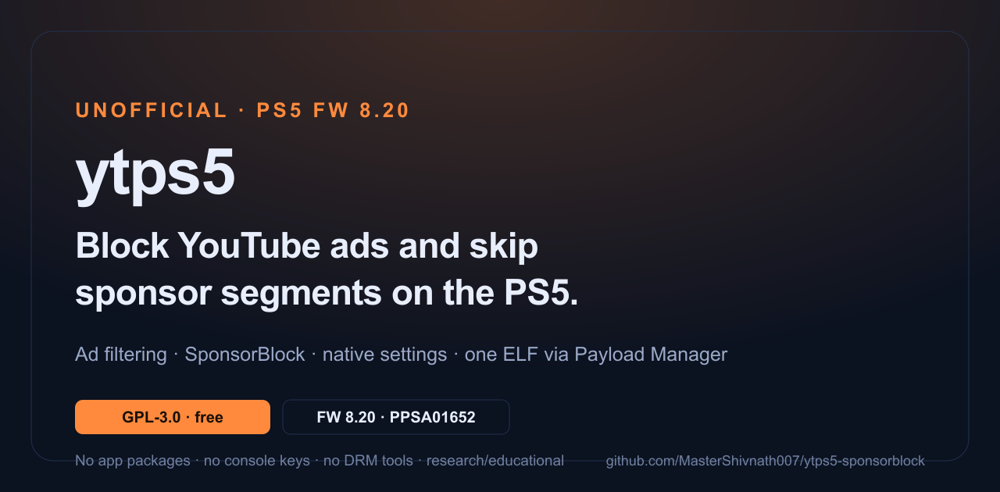
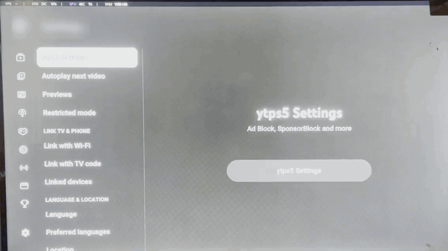

<p align="center">
  
</p>

# ytps5

[](https://github.com/MasterShivnath007/ytps5-sponsorblock/releases/latest)
[](LICENSE)
[](#compatibility)
[](https://github.com/sponsors/MasterShivnath007)

**Block YouTube ads and skip sponsor segments in the official PS5 video app — no package install, no app replacement.**

ytps5 is a runtime quality-of-life mod. It attaches to the app you already own
and patches the running process in memory: in-player, feed and hero ads are
filtered out, SponsorBlock segments are skipped, and settings live in a native
panel inside the app. It does **not** contain, modify, or redistribute the app,
app packages, console keys, DRM tools, or any copyrighted app files.



Settings live inside the app itself — section *Settings → ytps5 Settings*. No
second homebrew app, no package, no app replacement.

**Website:** https://mastershivnath007.github.io/ytps5-sponsorblock/

## Install in two minutes

**You need:** a jailbroken PS5 on **firmware 8.20**, the YouTube app
(**`PPSA01652`** by default — any `PPSA0165x` build works, see
[compatibility](#compatibility)), and a way to run an ELF (Payload Manager, or
any ELF loader).

1. **Download** [`ytps5.elf`](https://github.com/MasterShivnath007/ytps5-sponsorblock/releases/latest/download/ytps5.elf)
   — one file, about 9 MB.
2. **Add it to Payload Manager** → *local payloads* → add/upload `ytps5.elf`.
3. **Run `ytps5`** and wait for the toast **`ytps5: waiting for PPSA01652`**.
4. **Open the YouTube app** (`PPSA01652`). It freezes for a moment while the
   hook installs, then shows **`ytps5: hook installed`**.
5. **Change settings in the app:** *Settings → ytps5 Settings*.

<a id="install-details"></a>

<details>
<summary><b>Install details, autoload, and what the ELF actually does</b></summary>

The single ELF embeds the onboarding proxy and the injector. It only uses
network loopback to hand the real payloads to the console's own `elfldr`, so it
also works when launched directly by Payload Manager. Nothing is written to app
save data, `download0.dat`, or the Y2JB autoloader.

**Automatic start (optional).** To start everything after each boot/jailbreak:

- **Payload Manager:** add `ytps5.elf` to `autoload.txt`.
- **etaHEN:** place it in the payload autoload list.

**Every boot or every app launch?**

- **Every boot/jailbreak:** run the installer once — the patch is memory-only and
  a reboot clears it. Autoload makes this automatic.
- **Every app launch:** no. The resident injector waits for the app, patches it,
  waits for it to close, and patches the next launch automatically.
- **After a full console restart:** run `ytps5.elf` again, or rely on autoload.

</details>

> **Research and educational project.** Not affiliated with Sony, Google,
> YouTube, SponsorBlock, or any app vendor. No app packages, keys, DRM bypass
> tools, or copyrighted content are distributed. You must already own the app.
> **Tested on PS5 firmware 8.20 with YouTube `01.000.003`.** Any `PPSA0165x`
> build can be patched; the title is chosen in `config.txt`. Use at your own
> risk; no warranty. The Y2JB apps `PPSA01650`/`PPSA01651` are refused by
> default; patching them requires an explicit opt-in.

## Compatibility

| App | Role | Status |
| --- | --- | --- |
| `PPSA01650` | Y2JB daily driver | 🟡 **Works, but opt in.** Refused by default; needs `patch_title=PPSA01650` and `allow_y2jb=1`. |
| `PPSA01651` | Y2JB daily driver | 🟡 **Works, but opt in.** Refused by default; needs `patch_title=PPSA01651` and `allow_y2jb=1`. |
| `PPSA01652` | Clean player | 🟢 **Default target.** Same `01.000.003` build. |
| other `PPSA0165x` | Native PS5 app | 🟢 **Select with `patch_title=AUTO`.** |
| `CUSA01116` | PS4-compatibility app | ⚪ Unsupported. |

Which app gets patched is controlled by `/data/ytps5-sponsorblock/config.txt`
(created on first run). The default is `PPSA01652`, but **you are not limited to
it**: every build is `01.000.003`, so whichever YouTube app you own can be
patched by naming it in the config. The injector refuses
`PPSA01650`/`PPSA01651` unless you explicitly set `allow_y2jb=1`, because those
are commonly used as Y2JB daily drivers. Nothing writes to app save data,
`download0.dat`, or the Y2JB autoloader.

### Choosing which app to patch

The injector writes a commented config file on first run:

```ini
# /data/ytps5-sponsorblock/config.txt
patch_title=PPSA01652   # PPSA01650 | PPSA01651 | PPSA01652 | AUTO
allow_y2jb=0            # 1 = allow patching PPSA01650/PPSA01651
```

- **Patch the app you own:** `patch_title=` that title ID. All three builds are
  `01.000.003`, and the default is `PPSA01652`.
- **Keep Y2JB on one build and patch another:** e.g. `patch_title=PPSA01652`
  while Y2JB keeps `PPSA01650`.
- **Patch whichever `PPSA0165x` app appears first:** `patch_title=AUTO`. Y2JB
  titles are still refused unless `allow_y2jb=1`.

Edit the file over FTP (port `2121`) or with the console's file manager, then
restart `ytps5.elf` so the injector re-reads it.

> Patching a Y2JB app can break the jailbreak/autoload chain. Only enable
> `allow_y2jb=1` if you have a second clean app for Y2JB.

## What you get

- In-player ad objects removed before the UI renders them.
- Feed and hero sponsored cards filtered out.
- SponsorBlock segments fetched from the public API and skipped, with toasts.
- Native **ytps5 Settings** panel:
  - Ad Block on/off
  - SponsorBlock on/off
  - SponsorBlock category toggles
  - **Support master_shivnath** with a QR code and GitHub Sponsors link
- Update check against `version.json`; a toast appears when a newer release
  exists.
- The payload stays resident and **re-patches every app launch** until the
  console is rebooted.

## Settings and support

Open the app's **Settings** → **ytps5 Settings**. The native panel includes:

- Ad Block and SponsorBlock toggles.
- Individual SponsorBlock category toggles.
- **Support master_shivnath** → QR code and GitHub Sponsors.

Preferences are currently per-session. A native persisted config is on the
roadmap for the next update.

## Updates

`version.json` on the `main` branch is the update source:

```json
{
  "version": "1.1.0",
  "url": "https://github.com/MasterShivnath007/ytps5-sponsorblock/releases/latest",
  "notes": "Per-app selection via /data/ytps5-sponsorblock/config.txt"
}
```

The local proxy fetches it, compares it with the payload's `CURRENT_VERSION`,
and shows a toast if a newer version is available. To publish a release, bump
`version.json` and attach the new `ytps5.elf` to a GitHub Release.

## Troubleshooting

Logs on the console:

- `/data/ytps5-sponsorblock/injector.log`
- `/data/ytps5-sponsorblock/relay.log`
- `/data/ytps5-sponsorblock/proxy_server.log`

Common issues:

- **No toast after running the installer:** confirm `elfldr` is listening on
  `127.0.0.1:9021`; the installer hands the payloads to it.
- **SponsorBlock not skipping:** the local proxy must be running on port `4040`.
  The single installer starts it automatically.
- **App stuck on the launch screen:** reboot, rerun `ytps5.elf`, and open the
  configured app. If you enabled `allow_y2jb=1`, set it back to `0` and use a
  clean app.
- **Wrong app patched or nothing patched:** check `config.txt`; the injector
  waits for the exact `patch_title`. Restart `ytps5.elf` after editing it.
- **Update toast never appears:** `version.json` is fetched from `main`; make
  sure it is present and the console has network access.

When opening an issue, attach the three logs above and the exact app title ID
and version.

## Build from source

Requirements:

- PS5 payload SDK (John Törnblom)
- LLVM 18 for `llvm-config`
- Node.js + `npx` (only to minify the JavaScript payload)

```bash
export PS5_PAYLOAD_SDK=/opt/ps5-payload-sdk
export LLVM_CONFIG=/opt/homebrew/opt/llvm@18/bin/llvm-config

make minify      # payload/inject.src.js -> payload/inject.js
make installer   # build/ytps5-installer.elf (single-file release)
make dist        # dist/ytps5.elf + README/LICENSE/NOTICES/version.json
```

`payload/inject.src.js` is the readable source; `payload/inject.js` is the
minified file embedded in the injector. The `make` target regenerates the C
header automatically.

## How it works (short version)

1. The installer hands the proxy and injector to the console's `elfldr`.
2. The injector attaches to the app selected in `config.txt` (default
   `PPSA01652`) with libhijacker.
3. It installs a 14-byte jump on `HTMLScriptExecute` using a trampoline, and a
   tiny position-independent hook that prepends the JavaScript payload to
   scripts as they execute.
4. The JavaScript filters ad objects from app API responses, manages the video
   element, and talks to the local SponsorBlock proxy.
5. A `scePadRead` GOT trigger is used only as a safe place to apply the
   prologue patch; it never runs library code from disk.

See `docs/HOW_IT_WORKS.md` for details.

## Credits and prior art

`ytps5` builds on the PS5 homebrew ecosystem and on earlier Cobalt ad-skip
projects. Full details and license notes are in **[CREDITS.md](CREDITS.md)**;
the prior-art review is in **[RESEARCH.md](RESEARCH.md)**.

- **etaHEN-Plugins / libhijacker** — GPL-3.0, vendored headers, source, and
  archive.
- **PS5 payload SDK** — GPL-3.0+, compiler and stub libraries.
- **HDE64** — BSD-style instruction decoder.
- **[yt_adskip_ps4](https://github.com/earthonion/yt_adskip_ps4)** — prior PS4
  Cobalt ad-skip plugin. No code copied; cited as prior art.
- **[TizenTube](https://github.com/reisxd/TizenTube)** and
  **[TizenTubeCobalt](https://github.com/reisxd/TizenTubeCobalt)** — settings
  and SponsorBlock UX references. The native settings modal/QR renderer shapes
  are adapted from TizenTube's GPL-3.0 UI helpers; this project is also GPL-3.0.
- **[MuTube](https://github.com/Exaphis/mutube)** — Apple TV wrapper, studied as
  a reference. No code copied.
- **[Tube5-PS5](https://github.com/MrDerekib/Tube5-PS5)** — related native PS5
  client; no code used.
- **SponsorBlock** — independent public API/service, not affiliated.

At the time of the 1.0.1 release, no public project was found that patches the
official PS5 app at runtime with an ELF payload. If earlier work exists, open an
issue so it can be credited.

## Support the project

`ytps5` is free and GPL-3.0. If it saved you time:

- **[Sponsor monthly on GitHub](https://github.com/sponsors/MasterShivnath007)** —
  monthly or one-time support.
- One-time Razorpay support is temporarily paused while the payment page is
  sanitised. GitHub Sponsors is available.
- **Star and share** the repository or the latest release.

There is no paywalled feature, telemetry, or mandatory account. See
**[SUPPORT.md](SUPPORT.md)** for the full support policy.

## Roadmap

- Persist Ad Block / SponsorBlock preferences across app restarts.
- More detailed settings (per-category controls, playback options, proxy status).
- Investigate the occasional 4–5 video startup delay.
- Keep the `HTMLScriptExecute` signature current for future app updates.

## FAQ

### How do I block YouTube ads on a PS5?
On a jailbroken PS5, run `ytps5.elf` once with Payload Manager, then open your
YouTube app (default target `PPSA01652`; any `PPSA0165x` build works). ytps5
filters in-player, feed and hero ads in memory; it does not patch the installed
app package. See [Install](#install-in-two-minutes).

### Does ytps5 work on PS5 firmware 8.20?
FW 8.20 with YouTube `01.000.003` has been tested. Any `PPSA0165x` build of
that version can be patched; other firmware is untested because the
`HTMLScriptExecute` signature can differ.

### Do I need a jailbroken PS5?
Yes. ytps5 attaches to the running app with libhijacker and patches the process
in memory. It does not run on stock firmware.

### Is ytps5 free?
Yes. It is GPL-3.0, with no paywalled features, account, or telemetry.

### Will it work on PPSA01650 or PPSA01651?
Not by default. Those are commonly used as Y2JB daily drivers and are refused
unless you set `patch_title` to one of them and `allow_y2jb=1` in
`/data/ytps5-sponsorblock/config.txt`. The recommended setup is to leave the
Y2JB app alone and patch a clean app such as `PPSA01652`.

### Does it support SponsorBlock?
Yes. SponsorBlock segments are fetched from the public API through the local
proxy and skipped with a toast. Categories can be toggled in ytps5 Settings.

### Can I use it on a PS4 or PS5 Pro?
It targets the native PS5 app on FW 8.20. PS4-compatibility titles such as
`CUSA01116` and untested hardware are unsupported.

### How do I uninstall it?
Reboot the console, or close the app. The patch is memory-only and is not
written to the app, save data, or `download0.dat`.

### Where are the logs?
`/data/ytps5-sponsorblock/` contains `relay.log`, `injector.log`, and
`proxy_server.log`. Attach them to bug reports with your firmware and title ID.

## Legal and safety

Read **[DISCLAIMER.md](DISCLAIMER.md)** and **[TRADEMARKS.md](TRADEMARKS.md)**.
In short:

- This repository contains **no** app packages, console keys, DRM bypass
  tooling, or copyrighted app files.
- It does not modify the installed app package. The patch exists only in the
  running process's memory and disappears when the app or console restarts.
- The project is intended for research, education, and personal use on hardware
  you own and control. Check the laws and terms that apply to you.
- The tool refuses `PPSA01650` and `PPSA01651` by default because those are
  commonly used as Y2JB daily drivers. Patching them requires an explicit
  `allow_y2jb=1` opt-in and is unsupported.
- SponsorBlock is an independent community service. This project only calls its
  public API.

## License

GPL-3.0. See `LICENSE` and `THIRD_PARTY_NOTICES.md`.
